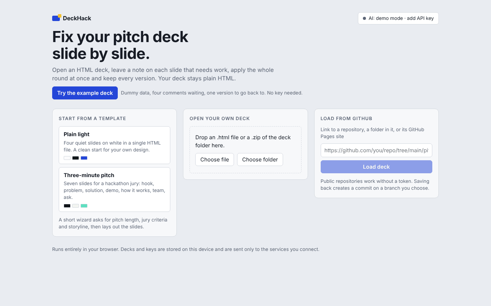
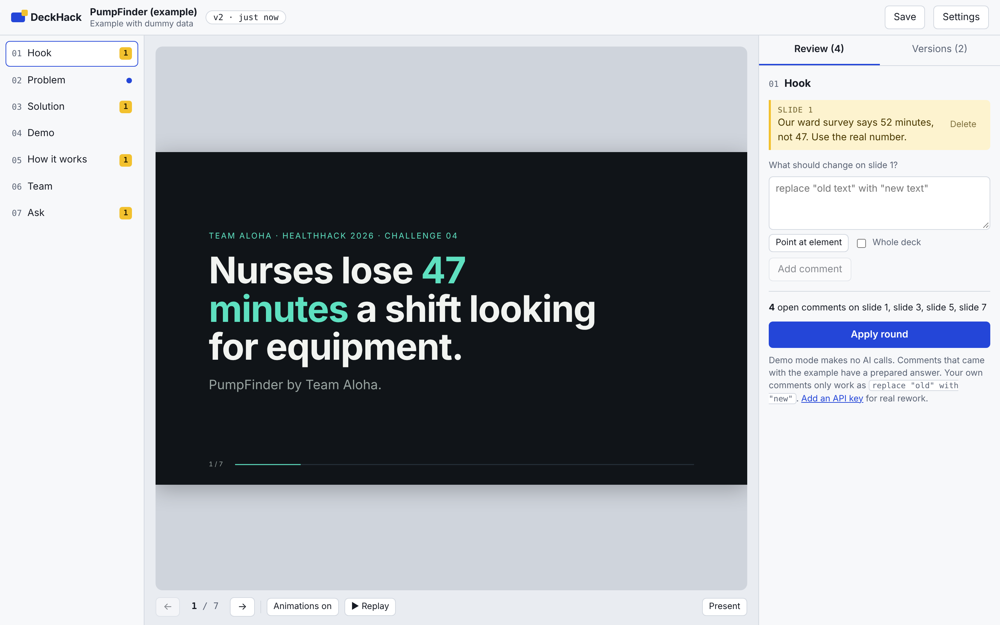
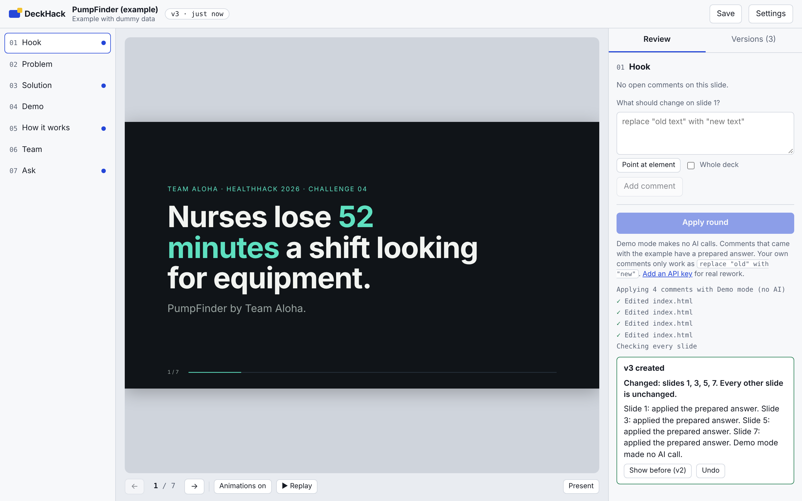
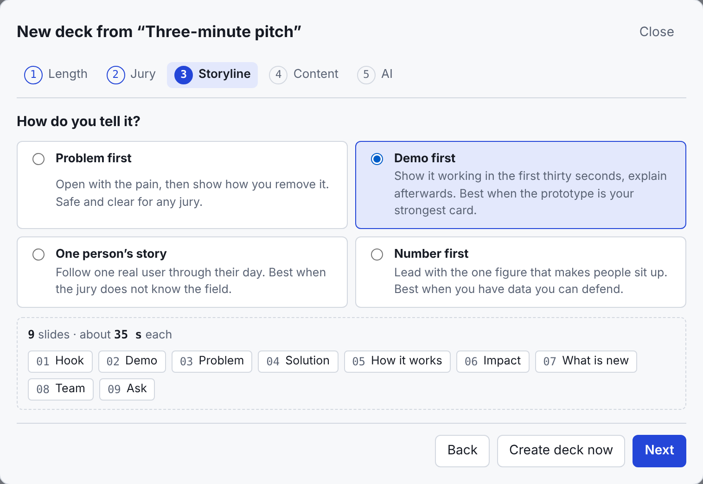

# DeckHack

**Fix your HTML pitch deck slide by slide.** Open a deck, leave a note on each slide that needs work, apply the whole round at once, and keep every version. Built for the last night of a hackathon.

DeckHack is a static web app. It has no server: decks, versions and keys stay in your browser, AI calls go straight to the provider with your own API key, and saving creates a commit in your own GitHub repository. Your deck stays a plain folder of HTML, CSS and JavaScript that runs without DeckHack.



## Run it locally

DeckHack is meant to run on your own computer. One command, no account, nothing hosted for you:

```bash
git clone https://github.com/clschulzer/DeckHack && cd DeckHack

docker compose up      # no Node needed, then open http://localhost:8080
# or, with Node 22:
npm ci && npm start    # builds, serves and opens http://localhost:4173
```

Another port for Docker: `DECKHACK_PORT=9000 docker compose up`. Your Claude key is entered in the app under Settings and goes from your browser straight to Anthropic.

The [project site](https://clschulzer.github.io/DeckHack/) is only a landing page. Its demo runs on dummy data and takes no keys.

> Status: the review loop, the example deck, the start wizard and the key handling work end to end in demo mode and are covered by tests. Everything that needs a real Anthropic key or GitHub token (a round with Claude, the live evals, committing to GitHub) is built but has not been run against the live services yet. [docs/TESTING.md](docs/TESTING.md) lists exactly what is and is not tested.

| Comment where it is wrong | See what changed | Start with the wizard |
| --- | --- | --- |
|  |  |  |

## What it does

- **Try it without anything:** “Try the example deck” opens a deck with dummy data, four comments waiting and a version to go back to. Demo mode answers them with prepared edits, no key needed.
- **Start wizard for templates:** pick the pitch length, the jury criteria and a storyline, type what the pitch is about, choose demo mode or your Claude API key. The wizard lays out the slides and marks missing facts as `[TODO]`.
- **Open a deck three ways:** a bundled template, your own file / folder / .zip, or a GitHub link (repository, folder, or GitHub Pages URL).
- **Any HTML deck.** Slides are detected by adapters: one element per slide (`section`, `.slide`, reveal.js), or decks that build scenes in JavaScript and show a counter such as `08 / 17`. An optional `deckhack.json` can pin the detection.
- **Comment where it is wrong.** Notes are pinned to a slide or to the whole deck and collected into one review round.
- **Apply the round.** The AI edits the deck's files with small, exact replacements. Then DeckHack reloads the deck, walks every slide and tells you which slides changed, so an edit to slide 8 that also moved slide 3 is flagged.
- **Every version is kept.** Compare before and after, undo, or restore any earlier version. Restoring adds a version; nothing is ever overwritten.
- **Play or freeze animations**, step through scripted scenes, present fullscreen.
- **Save** as a commit on a branch of your repository, or as a .zip.

## Develop

```bash
npm ci
npm run dev        # local dev server
npm run build      # the app as a static site in dist/
npm run build:pages   # landing page (site/) plus a demo-only build of the app under app/ (no key entry), as GitHub Pages serves it
npm run docker:check  # build the container, start it and check that it serves the app
```

Links into the app: `?example` opens the example deck, `?template=<id>` starts the wizard, `?deck=github.com/you/repo` loads a deck from GitHub.

## Check it

```bash
npm run typecheck
npm run lint
npm test           # unit tests (Vitest)
npm run build && npm run e2e                      # browser run of the review loop (Playwright)
npm run e2e -- path/to/your-deck.zip              # also load a real deck
ANTHROPIC_API_KEY=... npm run eval                # live evals of the AI rework (costs API usage)
npm run build && npm run media                    # regenerate screenshots and the demo GIF
```

The test strategy is in [docs/TESTING.md](docs/TESTING.md). The evals measure whether a rework changed only the commented slides, did what was asked and invented nothing: [evals/README.md](evals/README.md).

## How it is built

| Folder | Purpose |
| --- | --- |
| `src/core/` | Deck model, exact-match edits, preview bundler, the in-frame bridge, versions in IndexedDB |
| `src/sources/` | Loading from upload, GitHub and templates; committing to GitHub |
| `src/ai/` | Provider interface, Claude provider (browser, your key), demo provider, the review round |
| `src/ui/` | React interface |
| `templates/` | Starter decks. Each is a plain folder; add one and it appears in the app. Format: [templates/README.md](templates/README.md) |
| `evals/` | Cases and deterministic scoring for the AI rework |
| `site/` | Landing page for GitHub Pages; `site/media/` is generated by `npm run media` |

Security model in one paragraph: deck code is untrusted, whether it comes from a link, an upload or the AI. It only ever runs in an iframe with `sandbox="allow-scripts"`, which gives it an opaque origin. It cannot read the app's storage or your API key, cannot navigate the app and cannot open windows. The app and the preview talk through `postMessage` with a per-load token.

The full design, the roadmap and known risks are in [docs/ARCHITECTURE.md](docs/ARCHITECTURE.md) (German).

## Your API key

- By default the key lives in this tab only (`sessionStorage`) and is gone when you close it.
- “Remember keys on this device” is opt-in and shows a warning: the key is then stored unencrypted in the browser, readable by anyone using that browser profile, by other pages on the same web address and by extensions with access to the page. “Remove stored keys” in Settings deletes it again.
- Use a key made only for DeckHack, in its own workspace with a spend limit in the Anthropic Console. A lost key can then cost no more than that limit, and you can revoke it without touching anything else.
- Deck code never sees the key: the preview runs in an iframe with `sandbox="allow-scripts"` (no `allow-same-origin`), and a Content-Security-Policy lets the page and the preview connect only to `api.anthropic.com`, `api.github.com` and `cdn.jsdelivr.net`.
- If you host DeckHack yourself, give it its own domain or subdomain, so no other site shares its storage.

## Contributing

Templates, slide adapters for more deck formats and AI providers are the easiest places to start. See [CONTRIBUTING.md](CONTRIBUTING.md).

## License

MIT
